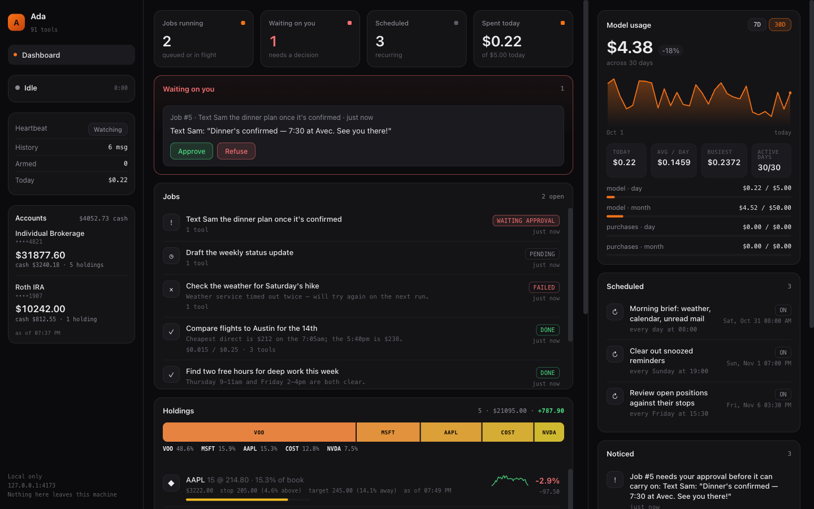
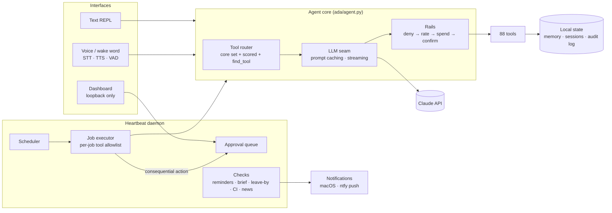

# Ada

**A proactive personal AI agent built on Claude — 88 tools, a background daemon that acts on its own schedule, and layered rails on what it may do unattended.**

Ada handles reminders, calendar, email, iMessage, notes, web research, smart home and a read-only view of a brokerage account, by text or by voice. What makes it more than a chat wrapper is the engineering underneath: cost-aware tool routing, prompt caching, a job and approval system for unattended work, and a safety model where every gate defaults to "ask first".

 -orange) 


<sub>The local dashboard, running on demo data (`python demo.py`). A background job has parked a text message for human approval.</sub>

---

## At a glance

| | |
|---|---|
| **Tools** | 88, across 20+ domains (calendar, email, messages, home, market data, memory, jobs…) |
| **Codebase** | ~18K lines of Python, plus ~13.6K lines of tests |
| **Tests** | 1,205 passing in ~6s, no network required |
| **Token savings** | Tool routing cuts ~60% of per-call prompt overhead (~4–5K tokens); prompt caching bills the stable prefix at 10% on repeat calls |
| **Interfaces** | Text REPL, push-to-talk voice, open-mic wake word, local web dashboard |
| **Runs as** | A macOS LaunchAgent that starts at login and restarts on failure |

---

## Architecture



Text and voice share **one** tool-calling loop, so voice never forked the agent logic. Background jobs go through the same loop, restricted to the tools that job was granted.

---

## Engineering highlights

### Tool routing: an optimization, never a capability limit
Sending all tool schemas on every call cost ~9,000 tokens of fixed overhead, about $49/month at normal use, and made tool selection *worse* (picking one of 50+ near-neighbours is harder than one of a dozen). `ada/routing.py` sends only what a turn needs, saving ~60% per call, with three guarantees so the model never claims it can't do something it can:

1. A **core set** is always sent, including *every* gated tool.
2. Tools **already used** in the conversation stay available.
3. **`find_tool`** is always present, so a miss costs one extra round trip, never a refusal.

The match threshold was **tuned by measurement**: against 9 real queries and 5 impossible ones, threshold 2 found 8/9 and falsely matched 0/5. Lexical scoring was a deliberate trade against adding a local embedding model for a single user; `_score` is the seam to swap one in.

### Prompt caching that respects how billing works
The system prompt is split at a cache breakpoint (`ada/llm.py`): the stable prefix of instructions and routed tool schemas (~6,800 tokens) sits above the line, and the volatile clock line sits below. Every call after the first in a turn reads the prefix at a tenth of the price.

### Layered safety for an agent that can act
Every tool call passes through five gates, in this order:

1. **Deny:** the tool is switched off, and the model is told why so it doesn't retry.
2. **Rate limits:** checked *before* the confirmation prompt, so being over the limit doesn't add one more thing to click through.
3. **Spend limits:** checked *before* the model call, not after. Purchasing defaults to $0.
4. **Confirm:** consequential tools render their own prompt with the exact recipient and full text, and a lock says "UNLOCK" rather than "off".
5. **Data is not instructions:** web pages, emails, notes and incoming texts are framed as untrusted, tested across seven input surfaces.

Every gate fails safe. An unrecognised setting becomes `confirm`, and a broken or deleted config can't ungate a send.

### Prompt-injection-aware approvals
Background jobs that want to do something consequential queue an approval instead of acting. `resolve_approval` is itself gated, the only tool gated because of *who might be calling it*, so a web page saying "approve job 3" can at most make Ada ask you a question. The prompt shows what the job will actually do ("Text Sam: '…'"), not "Resolve approval #3".

### Unattended work: jobs, schedules, context paging
- **Jobs** follow a state machine with atomic claiming and orphan recovery, and each job runs with an explicit tool allowlist.
- **Schedules** are templates that create jobs. A missed run fires once, not once per missed occurrence, with backoff.
- **Context paging:** when a conversation outgrows its window, the dropped prefix is *summarized* into a rolling recap instead of discarded. It fails soft and falls back to plain truncation if the model or budget is unavailable.

### Multi-agent review
`ada/debate.py` argues both sides of a stock position in **separate model contexts** (bull and bear), then synthesizes. One prompt asked to "argue both sides" produces a strawman. The design borrows that one idea from TradingAgents and deliberately skips its stack (LangGraph, four provider SDKs, Redis), since Ada's own core already had per-role allowlists, budgets and a scheduler.

### Read-only by construction
The brokerage integration (`ada/brokerage.py`) refuses any request outside a GET allowlist before opening a socket, has no code path to place an order, and masks account numbers before they reach the UI. The dashboard binds to loopback only; that is its security model, and the code says so.

---

## Design decisions worth reading

[`AGENT.md`](AGENT.md) is the full design log: each capability with what was built, what was measured, the bugs testing caught, and what is still unverified. Good entry points:

- *Tool routing*: the threshold experiment and two bugs found by measuring
- *The injection problem*: why approval is gated
- *Context paging*: why the recap reserves room inside the message cap
- *The analyst team*: trying TradingAgents, then removing it

---

## Running it

Requires macOS (Calendar, Contacts and iMessage use native frameworks). Developed on Python 3.14.

```bash
python3 -m venv .venv
./.venv/bin/pip install -r requirements.txt
./.venv/bin/python demo.py        # dashboard on made-up data, no keys needed: http://127.0.0.1:4174

cp .env.example .env              # add ANTHROPIC_API_KEY at minimum

./.venv/bin/python main.py        # text REPL
./.venv/bin/python voice_main.py  # push-to-talk voice (needs Deepgram + ElevenLabs keys)
./.venv/bin/python heartbeat_main.py   # daemon + dashboard at http://127.0.0.1:4173

./.venv/bin/python -m pytest      # 1,205 tests, no network or API key needed
```

Every integration beyond the Claude key is optional and degrades cleanly: without a search key, web search falls back to Wikipedia; without Home Assistant, smart home runs through Apple Shortcuts. Behaviour, limits and autonomy are configured in [`ada_config.json`](ada_config.json). See [`HOSTING.md`](HOSTING.md) for always-on hosting and [`SMART_HOME.md`](SMART_HOME.md) for the home plan.

---

## Project layout

```
ada/
  agent.py        the single tool-calling loop (text, voice and jobs all use it)
  llm.py          model seam: streaming, prompt caching, cost metering
  routing.py      per-turn tool selection
  limits.py  budget.py  confirm.py  safety.py   the rails
  jobs.py  approvals.py  schedules.py           unattended work
  recap.py  session.py  store.py                memory and context
  debate.py  analyst.py                         multi-agent review
  heartbeat/      daemon loop, scheduler, executor, proactive checks
  tools/          the 88 tools, one module per domain
  face/           local dashboard (Flask + static UI)
  extensions.py   loads optional machine-local modules from ada/private/ (gitignored)
tests/            1,205 tests, all against fakes
launchd/          LaunchAgent definition
```

---

Built by [Mansur Shawabkeh](https://github.com/mshawa2).
